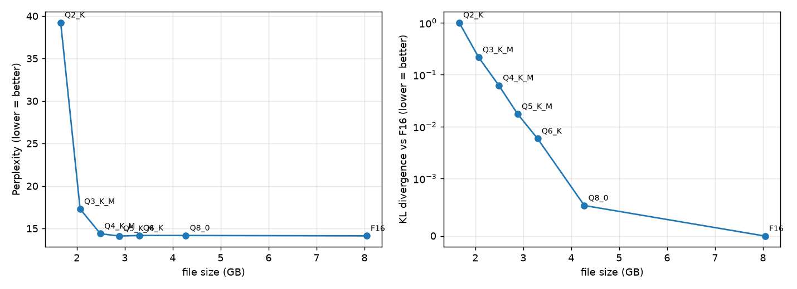

# Results

## Step 1: absmax on model.layers.10.mlp.gate_proj.weight (Qwen3-1.7B, shape (6144, 2048))

| bits | granularity | MSE | max error | bpw |
|---|---|---|---|---|
| int8 | tensor | 2.700e-06 | 0.0028 | 8.0000 |
| int8 | channel | 1.183e-07 | 0.0028 | 8.0078 |
| int8 | 256 | 7.867e-08 | 0.0028 | 8.0625 |
| int8 | 128 | 6.640e-08 | 0.0028 | 8.1250 |
| int8 | 64 | 5.456e-08 | 0.0028 | 8.2500 |
| int8 | 32 | 4.336e-08 | 0.0028 | 8.5000 |
| int8 | 16 | 3.281e-08 | 0.0028 | 9.0000 |
| int4 | tensor | 7.386e-04 | 0.0515 | 4.0000 |
| int4 | channel | 3.866e-05 | 0.0515 | 4.0078 |
| int4 | 256 | 2.582e-05 | 0.0515 | 4.0625 |
| int4 | 128 | 2.181e-05 | 0.0515 | 4.1250 |
| int4 | 64 | 1.793e-05 | 0.0515 | 4.2500 |
| int4 | 32 | 1.424e-05 | 0.0515 | 4.5000 |
| int4 | 16 | 1.077e-05 | 0.0483 | 5.0000 |

```
Outlier block (index 170864): max|w|=0.3750, median|w|=0.0066, s=0.0536
  29/32 weights become 0 (int4); values q: [0, 0, 0, 0, -1, 0, -4, 0, 0, 0, 0, 0, 0, 0, 0, 0, 0, 0, 0, 0, 0, 0, -7, 0, 0, 0, 0, 0, 0, 0, 0, 0]
  Typical block: s=0.0098, 4/32 zeros, q range -6..7
  Fraction of zeros over all blocks: 14.09%
```

## Step 2: Q8_0 and Q4_0 from scratch (model.layers.10.mlp.gate_proj.weight, Qwen3-1.7B)

| format | bytes/block | bpw | bytes equal to gguf | max dequant difference | MSE |
|---|---|---|---|---|---|
| Q8_0 | 34 | 8.5 | 100.0000% | 0.0e+00 | 4.342e-08 |
| Q4_0 | 18 | 4.5 | 100.0000% | 0.0e+00 | 1.115e-05 |
| int4 symmetric (step 1, block 32) | - | 4.5 | - | - | 1.424e-05 |

## Step 3: Qwen3-4B, GGUF variants (WikiText-2 test, ctx 512, 100 chunks)

| variant | size (GB) | bpw | PPL | ΔPPL vs F16 | KLD | same top-1 % | pp t/s | tg t/s | tg-speedup |
|---|---|---|---|---|---|---|---|---|---|
| F16 | 8.05 | 16.00 | 14.136 | +0.0% | 0.0000 | 100.0 | 557 | 15.1 | 1.00x |
| Q8_0 | 4.27 | 8.50 | 14.181 | +0.3% | 0.0005 | 99.0 | 533 | 28.2 | 1.87x |
| Q6_K | 3.30 | 6.56 | 14.180 | +0.3% | 0.0058 | 96.6 | 506 | 36.5 | 2.43x |
| Q5_K_M | 2.88 | 5.73 | 14.114 | -0.2% | 0.0174 | 94.5 | 480 | 37.0 | 2.46x |
| Q4_K_M | 2.49 | 4.95 | 14.398 | +1.9% | 0.0621 | 90.2 | 514 | 44.9 | 2.98x |
| Q3_K_M | 2.07 | 4.12 | 17.297 | +22.4% | 0.2158 | 82.7 | 491 | 37.8 | 2.51x |
| Q2_K | 1.66 | 3.31 | 39.237 | +177.6% | 1.0129 | 65.2 | 505 | 47.3 | 3.14x |



Notes on step 3:
- ΔPPL is relative to the standalone F16 run (14.136). The "PPL(base)" in the KL logs (13.97) is 1.2% lower and therefore not usable as a baseline (cause not investigated; presumably the compressed stored logits).
- PPL has ±0.31 absolute uncertainty (100 chunks); the ΔPPL between variants is paired and more accurate. Q5_K_M < Q6_K/Q8_0 in PPL is noise; KLD does order them correctly.
- tg speed: 3 repetitions (-r 3), roughly ±2%.

## Step 4: imatrix (calibration: WikiText-2 train, 200 chunks x 512; evaluation: test, 100 chunks)

| type | size (GB) | bpw | PPL | ΔPPL | KLD without | KLD with imatrix | KLD reduction | top-1 without | top-1 with |
|---|---|---|---|---|---|---|---|---|---|
| Q8_0 | 4.28 | 8.51 | 14.18 → 14.18 | +0.3% | 0.0005 | 0.0005 | 0% | 99.0 | 99.0 |
| Q6_K | 3.31 | 6.58 | 14.18 → 14.20 | +0.5% | 0.0058 | 0.0047 | 19% | 96.6 | 96.9 |
| Q4_K_M | 2.50 | 4.97 | 14.40 → 14.69 | +3.9% | 0.0621 | 0.0422 | 32% | 90.2 | 91.8 |
| Q3_K_M | 2.08 | 4.13 | 17.30 → 15.21 | +7.6% | 0.2158 | 0.1403 | 35% | 82.7 | 85.2 |
| Q2_K | 1.67 | 3.32 | 39.24 → 16.33 | +15.6% | 1.0129 | 0.4039 | 60% | 65.2 | 75.1 |
| IQ2_XS | 1.35 | 2.69 | 19.98 | +41.3% | n/a | 0.7626 | n/a | n/a | 65.8 |

PPL: 'without → with'. ΔPPL vs F16 (14.136). IQ2_XS does not exist without imatrix.

## Step 5A: NF4 vs Q4_0 (MSE on weights, Qwen3-1.7B)

| tensor | kurtosis | Q4_0 block32 (4.50 bpw) | NF4 block32 (4.50) | NF4/Q4_0 | Q4_0 block64 (4.25) | NF4 block64 (4.25) | NF4/Q4_0 | NF4 block64 + DQ (4.13) |
|---|---|---|---|---|---|---|---|---|
| L10.self_attn.q_proj | 4.6 | 9.063e-06 | 8.975e-06 | 0.99 | 1.129e-05 | 1.009e-05 | 0.89 | 1.009e-05 |
| L10.self_attn.k_proj | 4.0 | 8.291e-06 | 8.284e-06 | 1.00 | 1.026e-05 | 9.285e-06 | 0.90 | 9.287e-06 |
| L10.self_attn.v_proj | 3.4 | 9.147e-06 | 8.992e-06 | 0.98 | 1.130e-05 | 1.010e-05 | 0.89 | 1.010e-05 |
| L10.self_attn.o_proj | 4.5 | 7.529e-06 | 7.608e-06 | 1.01 | 9.250e-06 | 8.492e-06 | 0.92 | 8.493e-06 |
| L10.mlp.gate_proj | 4.2 | 1.115e-05 | 1.099e-05 | 0.99 | 1.392e-05 | 1.241e-05 | 0.89 | 1.241e-05 |
| L10.mlp.up_proj | 3.7 | 9.287e-06 | 9.108e-06 | 0.98 | 1.159e-05 | 1.029e-05 | 0.89 | 1.029e-05 |
| L10.mlp.down_proj | 4.6 | 8.883e-06 | 8.229e-06 | 0.93 | 1.138e-05 | 9.485e-06 | 0.83 | 9.486e-06 |
| L0.mlp.gate_proj | 3.8 | 1.149e-05 | 1.143e-05 | 0.99 | 1.429e-05 | 1.284e-05 | 0.90 | 1.284e-05 |
| L27.mlp.gate_proj | 3.9 | 1.044e-05 | 1.050e-05 | 1.01 | 1.292e-05 | 1.176e-05 | 0.91 | 1.177e-05 |

Mean NF4/Q4_0 MSE ratio: block32 0.99, block64 0.89. Kurtosis: normal = 3.

## Step 5B: GPTQ-light vs RTN (L10 gate_proj, int4, block 32, calibration 32768 train tokens, damp 0.01)

| method | weight MSE | output error (test) | relative output error (test) | relative output error (train) |
|---|---|---|---|---|
| RTN | 1.424e-05 | 9.061e-03 | 3.922e-03 | 3.871e-03 |
| GPTQ | 2.040e-05 | 4.095e-03 | 1.773e-03 | 1.354e-03 |

GPTQ/RTN: weight-MSE 1.43x, output error (test) 0.45x
