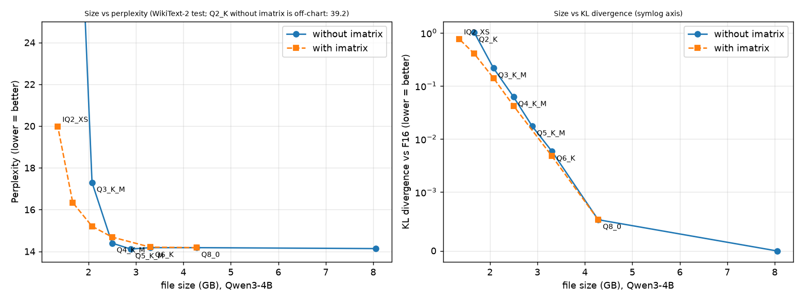

# Summary: LLM quantization with Qwen3-4B on an M3 Pro

Model: Qwen3-4B (F16 baseline 8.05 GB), llama.cpp (commit `690b87d`, Metal), 18 GB unified memory.
Evaluation: WikiText-2 **test**, ctx 512, 100 chunks. Calibration (imatrix): WikiText-2 **train**, 200 chunks.
Scripts are in `experiments/`, raw tables in `results.md`, per-step lessons in `notes.md`, method in `methodology.md`.

## 1. Result

| variant | GB | bpw | PPL | ΔPPL | KLD | same top-1 | pp t/s | tg t/s | tg vs F16 |
|---|---|---|---|---|---|---|---|---|---|
| F16 | 8.05 | 16.00 | 14.14 | – | 0 | 100% | 557 | 15.1 | 1.0× |
| Q8_0 | 4.27 | 8.50 | 14.18 | +0.3% | 0.0005 | 99.0% | 533 | 28.2 | 1.9× |
| Q6_K | 3.30 | 6.56 | 14.18 | +0.3% | 0.0058 | 96.6% | 506 | 36.5 | 2.4× |
| Q5_K_M | 2.88 | 5.73 | 14.11 | −0.2% (noise) | 0.0174 | 94.5% | 480 | 37.0 | 2.5× |
| Q4_K_M | 2.49 | 4.95 | 14.40 | +1.9% | 0.0621 | 90.2% | 514 | 44.9 | 3.0× |
| Q3_K_M | 2.07 | 4.12 | 17.30 | +22% | 0.2158 | 82.7% | 491 | 37.8 | 2.5× |
| Q2_K | 1.66 | 3.31 | 39.24 | +178% | 1.0129 | 65.2% | 505 | 47.3 | 3.1× |

With imatrix (same file size, apart from a few MB):

| type | PPL without → with | KLD without → with | KLD reduction | same top-1 without → with |
|---|---|---|---|---|
| Q8_0 | 14.18 → 14.18 | 0.0005 → 0.0005 | 0% | 99.0 → 99.0 |
| Q6_K | 14.18 → 14.20 | 0.0058 → 0.0047 | 19% | 96.6 → 96.9 |
| Q4_K_M | 14.40 → 14.69 | 0.0621 → 0.0422 | 32% | 90.2 → 91.8 |
| Q3_K_M | 17.30 → 15.21 | 0.2158 → 0.1403 | 35% | 82.7 → 85.2 |
| Q2_K | 39.24 → 16.33 | 1.0129 → 0.4039 | 60% | 65.2 → 75.1 |
| IQ2_XS (2.69 bpw, 1.35 GB) | 19.98 | 0.7626 | n/a | 65.8 |

Note for Q4_K_M and Q6_K: PPL went up slightly with imatrix while KLD went down. Cause not investigated.

## 2. When do I pick what?

| type | pick it when | rationale |
|---|---|---|
| **F16** | you need a reference (KL baseline) or memory is certainly sufficient | 8 GB, 15 t/s |
| **Q8_0** | you want no quality risk and 4.3 GB fits | KLD 0.0005, practically indistinguishable from F16; imatrix does nothing |
| **Q6_K** | rarely: intermediate step | KLD 0.006, but Q5_K_M is smaller for practically the same quality |
| **Q5_K_M** | you want quality without thinking about it | 2.9 GB, KLD 0.017, 94.5% same top-1 |
| **Q4_K_M + imatrix** | **default choice** | 2.5 GB (3.2× smaller), 3× faster tg, +1.9 to +3.9% PPL, KLD 0.04, 92% same top-1 |
| **Q3_K_M + imatrix** | memory is really too tight for Q4 | +7.6% PPL with imatrix; +22% without |
| **Q2_K / IQ2_XS + imatrix** | emergency or experiment only | Q2_K only works with imatrix (PPL 39 → 16); expect noticeably worse answers |
| **NF4 (bitsandbytes)** | you work in PyTorch/CUDA rather than GGUF | cannot run on this machine; only an MSE comparison was done |
| **GPTQ/AWQ** | you have a GPU pipeline and want a better 4-bit point | only one layer of GPTQ reproduced; no end-to-end comparison |

## 3. The five most important insights

1. **"N-bit" says nothing about the storage cost; look at bpw.** Every block has its own scale: `bpw = b + 16/B`. Q4_0 is 4.5 bpw, Q4_K 4.5 with quantized sub-scales, and Q4_K_M 4.95 because the recipe puts `attn_v`/`ffn_down` (half of the layers) and `token_embd` on Q6_K. Compare methods only on a common axis: file size or bpw, never on the name.

2. **A single outlier determines the resolution of a whole group.** The scale is `max|x|/(2^(b−1)−1)`, so in the worst block of 32 (max 0.375, median 0.0066) 29 of the 32 weights became 0. Granularity works in steps: tensor → channel gave 19× lower MSE, after that ~1.25× per halving of the block, against 16/B extra bits. At equal bpw, Q4_0 still reached 1.28× lower MSE than symmetric int4, purely by using all 16 levels and a step of `max/8`.

3. **Quality is non-linear in bits, with a knee between Q4 and Q3.** Down to Q5_K_M the damage is ≤ 0.017 KLD; Q4_K_M is slightly noticeable (KLD 0.06); Q3_K_M and Q2_K are not (0.22 and 1.0). KLD falls roughly log-linearly with size (see the right-hand chart). So measure **KLD against F16** next to PPL: PPL is noise of ±0.3 absolute on 100 chunks (Q5_K_M looks "better than F16"), while KLD ranked all six variants correctly.

4. **Token generation is bandwidth-bound, prompt processing is compute-bound.** One token reads each weight matrix once (≈2 FLOPs per weight): `tg ≈ bandwidth / file size`, here ≈ 120 GB/s (F16 15.1 t/s, Q8_0 28.2, Q4_K_M 44.9). pp reuses every weight for 512 tokens and stayed flat (480–557 t/s; F16 is even the fastest, since there is nothing to unpack). Below ~4 bits Q3_K_M and Q2_K reached only ~78 GB/s: unpacking the bits becomes the bottleneck, so Q3_K_M is slower than Q4_K_M despite a smaller file.

5. **Minimize the output error, not the weight error.** The imatrix weights columns by the mean of `x[j]²` (magnitude and frequency of the activation) and turned out to be nearly free: −60% KLD for Q2_K, −32% for Q4_K_M, 0% for Q8_0, because with 256 levels there is nothing to choose. GPTQ goes further and on one layer gives a 2.2× lower output error at a 1.43× *higher* weight MSE, because errors are pushed through `H⁻¹` onto later columns. Both win on the calibration data: GPTQ was 0.35× of RTN on train but 0.45× on test. It is calibration, not training, and the data you calibrate on is a model parameter.

## 4. Three follow-up questions

1. **Activation quantization (W8A8, W4A8).** We only quantized weights, and the matmul then ran with fp16/fp32 activations. If the activations are int8 too, compute-bound pp can get faster. But activations have extreme per-channel outliers (see SmoothQuant). Which channels are those in Qwen3-4B, and how much PPL/KLD does it cost if you quantize the activations of a single layer?

2. **KV-cache quantization.** At long context the KV cache (like the weights) costs bandwidth per token. In llama.cpp this is possible via `--cache-type-k`/`--cache-type-v` (for example `q8_0`, `q4_0`). From which context length does the KV cache beat the weights in memory and bandwidth for this model, and what is the KLD cost of K versus V (K is often more sensitive)?

3. **QAT and the limits of PTQ.** All methods here are *post-training*. How much of the knee between Q4 and Q3 (and of Q2_K) is fundamental, and how much is a closable gap? You can test this by putting a small quantization-aware finetune (or a light approach such as LoRA on a quantized model, QLoRA style) next to PTQ at the same bpw, and checking whether the KLD curve shifts.

## 5. Limitations and what was not tested

- One model (Qwen3-4B), one dataset (WikiText-2), only PPL and KLD; no tasks, reasoning or code.
- PPL is based on 100 chunks (±0.31 absolute). The `PPL(base)` that `llama-perplexity` computes in KL mode from the stored logits file (13.97) deviates 1.2% from a real F16 run (14.14); I use the latter as baseline.
- Speed: 3 repetitions per variant; only valid for this machine.
- The imatrix was built on WikiText-train and evaluated on WikiText-test: same style. A domain-foreign test (code, other languages) was not done, so the gain may be optimistic.
- NF4 and GPTQ were reproduced at the weight level (NF4: MSE, 9 tensors; GPTQ: one layer, output error), not end-to-end. At block 64 NF4 gave 11% lower MSE than Q4_0 but at block 32 no difference (0.99×); the explanation is a hypothesis.
- The PPL increase of Q4_K_M and Q6_K with imatrix while KLD dropped is not explained.
